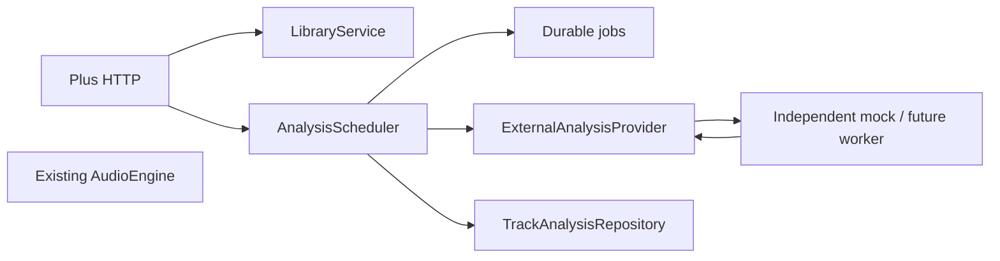

# LivePlay+ Phase 1.6: analysis foundation and external worker boundary

Analysis is optional server-side data. Neither AudioEngine, ProjectState, playback commands nor `.liveplay` reference these services. No analyzers, models, music DSP or Python runtime have been added. All analysis capabilities are false.

## Implemented interfaces

`server/include/liveplay/analysis/analysis.hpp` defines:

- `AnalysisJob`: Track ID, content hash, provider ID, asset path, schema version, status and error.
- `TrackAnalysisRepository`: optional per-track lookup and atomic save. `JsonTrackAnalysisRepository` stores bounded individual documents under `plus/analysis/tracks/<track_id>.json`.
- `AnalysisProvider`: provider identity, capabilities and execution contract. No concrete production provider is installed.
- `AnalysisScheduler`: bounded queue, durable jobs, deduplication by Track/provider/version 1, retry of failed jobs, recovery of running jobs as pending, worker stop and error isolation.

Jobs are persisted separately in `plus/analysis/jobs.json` (256 jobs maximum, 8 MiB read bound). No analysis is enqueued automatically on import. An empty scheduler performs no processing. Requests for unavailable providers end as failed jobs with explicit errors. Failed records have null analytical values. A stopped scheduler rejects new jobs; Track access and playback remain available.

The scheduler dispatches providers from a separate orchestration thread and yields while Performance Mode detects active playback. `ExternalAnalysisProvider` is now the process adapter: one hidden external process per request on Windows, bounded JSON Lines stdout (8 MiB), timeout, cancellation, correlation checking and forced termination on timeout/crash. A fresh process is created for the next request after failure. The bundled worker is a mock only; no MIR algorithm, Python runtime or model ships.



## Versioned nullable schema

```json
{
  "track_id": "track_<sha256>",
  "analysis_version": 1,
  "status": "pending",
  "providers": {},
  "basic": {"duration_ms": null, "peak_dbfs": null, "rms_dbfs": null},
  "loudness": {"integrated_lufs": null, "true_peak_dbtp": null, "lra": null},
  "rhythm": {"bpm": null, "confidence": null, "beats": []},
  "tonality": {"key": null, "scale": null, "camelot": null, "confidence": null},
  "structure": {"sections": []}
}
```

Analytical sections and fields can be omitted/null. Track ID and version are required. Present sections must be objects or null; supported statuses are pending/running/completed/failed. Documents are bounded at 8 MiB. A completed record includes content hash and provider provenance. Consumers must distinguish absent/null data from a measured zero.

This initial schema validates identity, version, section envelopes and size. Algorithm-specific units, confidence ranges, finite values and array element constraints must be validated by the next provider adapter. Version 1 does not encode multiple model/configuration cache generations: add algorithm/model version and parameters to the cache key before installing analyzers. Unknown schema versions fail explicitly.

## JSON/IPC protocol

`ExternalAnalysisProvider` defines and validates the process boundary. Use newline-delimited UTF-8 JSON on stdin/stdout with a maximum 8 MiB envelope; logs go to stderr. The concrete protocol is [ANALYSIS_WORKER_PROTOCOL](ANALYSIS_WORKER_PROTOCOL.md). The currently implemented request is:

```json
{
  "protocolVersion": 1,
  "type": "analyze",
  "requestId": "request-uuid",
  "trackId": "track_<sha256>",
  "path": "C:/.../plus/assets/<hash>.wav",
  "contentHash": "sha256:<hash>"
}
```

Successful response:

```json
{
  "protocolVersion": 1,
  "type": "result",
  "requestId": "request-uuid",
  "status": "ok",
  "data": {}
}
```

The adapter rejects a mismatched request ID, unsupported version, malformed/oversized output and non-object data. It maps the valid nullable data to the TrackAnalysis record and translates an error, crash, timeout or cancellation into a failed job. It must not trust executable paths from HTTP input.

Windows deployment: hidden worker process, Unicode paths, bounded concurrency, CPU baseline, no WSL requirement. Heavy workers can later be Python for Essentia/MIR, but runtimes, packages, weights, licenses and reproducible installation must be reviewed first. No Internet or LLM dependency is permitted in audio rendering. Provider failure must never request transport changes.

## HTTP and capabilities

- `GET /api/plus/analysis/jobs`: durable job list.
- `POST /api/plus/analysis/jobs`: `{track_id, provider}`; 202. Unavailable providers fail asynchronously.
- `GET /api/plus/analysis/tracks/<id>`: optional record; 404 when absent.
- `GET /api/plus/capabilities`: `analysis: {basic:false,loudness:false,rhythm:false,tonality:false,structure:false,semantic:false,stems:false}`. `analysisAvailable:false` supplies an explicit aggregate flag.

These routes reuse operator authentication and exclude filesystem access by API tokens. Analysis initialization failure does not disable library or legacy playback. No WebSocket frames or project fields were added.

## Validation and deferred work

Native tests exercise the empty/stopped scheduler, nullable/failed records, running-job recovery, independent Track access and protocol correlation rejection. HTTP E2E submits an unavailable provider and verifies project/cue snapshots remain unchanged. This validates data/control isolation, not an uninterrupted-audio latency guarantee under CPU/IO contention.

Before a real provider: versioned cache keys, granular schema validators, concurrency/resource budgets, job history/compaction, all-or-nothing result ownership across multiple providers, malformed-store backups and a corpus with live audio contention measurements. No AutoDJ, beatmatching, stems or AI is part of this phase.

## Phase 2 addendum

The statement above that no analyzers ship is superseded for musical analysis: an optional `librosa-mir` provider (external Python worker) now exists. See [PHASE_2_SMART_MUSIC_ENGINE](PHASE_2_SMART_MUSIC_ENGINE.md). The scheduler gained per-provider result sinks, force re-run, cancellation, idle release and a 4096-job bound; musical results live in `analysis/musical/` and never replace the per-track loudness record.
