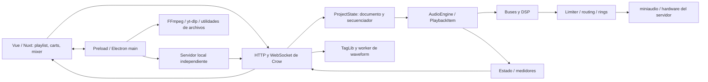
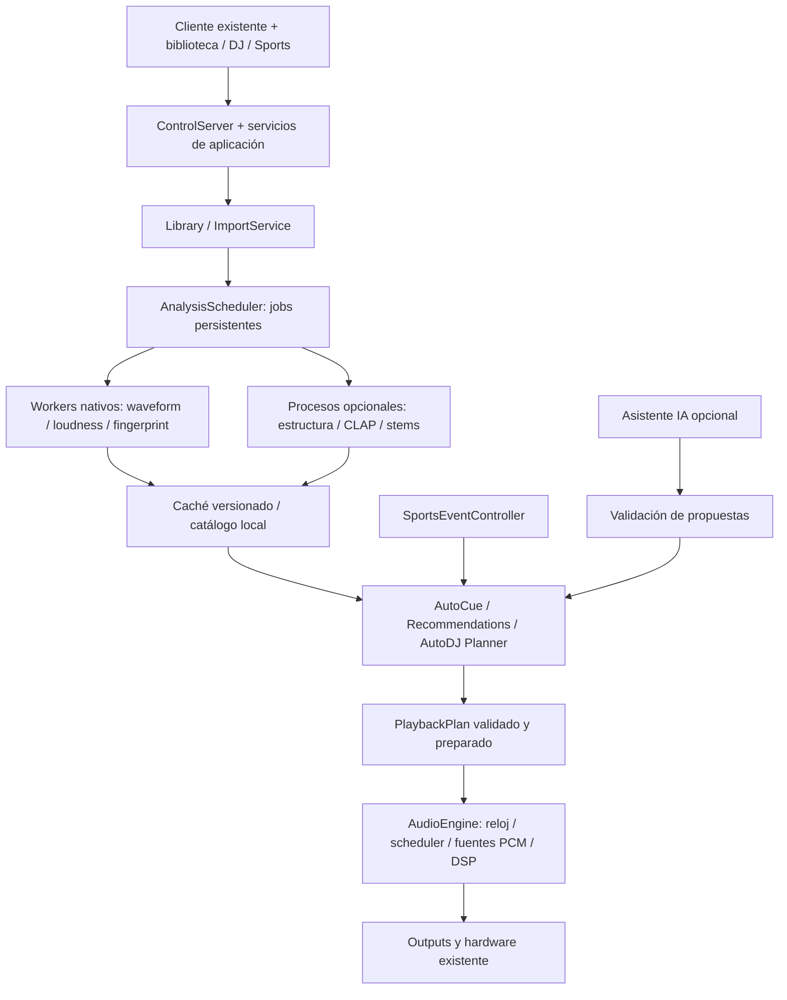

# LivePlay+: arquitectura actual y propuesta de evolución

Fecha de revisión: 2026-09-30. Base: LivePlay 2.5.0, commit `44ac17c885ff4a6dde96e8332001735494ccc50e`.

Este documento conserva el diagnóstico inicial y la propuesta modular para LivePlay+. Library/Import y la foundation de análisis ya están implementados hasta Phase 1.5; los módulos musicales futuros siguen siendo propuesta. El estado actualizado aparece al final y en LIBRARY_IMPORT.md / ANALYSIS_ARCHITECTURE.md.

## 1. Alcance y conclusión

Se revisaron los manifiestos, la estructura de cliente/servidor, las rutas de reproducción, importación, estado, persistencia y comunicaciones, los procesadores DSP, las pruebas disponibles, scripts de build, CI y documentación existente. Se consultaron fuentes oficiales de las herramientas candidatas. Es una revisión estática de arquitectura; no certifica el comportamiento de todas las rutas ni el rendimiento de audio en hardware real. Las decisiones de dependencias requieren una prueba de empaquetado y evaluación de la versión exacta antes de incorporarlas.

El conector `codebase-memory-mcp` no está disponible en esta sesión; el descubrimiento se realizó con inventario de archivos, `rg` y lecturas dirigidas. No se encontró `AGENTS.md` en el repositorio.

**Conviene extender LivePlay, no sustituir su motor.** Ya existen show control, mezcla, routing, DSP, secuenciación, persistencia y control remoto. Las principales piezas nuevas son una biblioteca independiente de la playlist, una cola persistente de análisis, descriptores musicales versionados y un planificador AutoDJ. Beat sync necesita además un reloj de frames y ejecución programada dentro del motor; el secuenciador actual de 50 ms no basta.

Documentación complementaria: [buses](BUS_ARCHITECTURE.md), [propiedad del estado](OWNERSHIP_MODEL.md), [auditoría de API](API_AUDIT.md), [desarrollo](DEVELOPMENT.md) y [roadmap](ROADMAP.md). La fuente de cada subsistema se enlaza a continuación.

## 2. Mapa del repositorio

| Área | Stack / responsabilidad | Entrada relevante |
|---|---|---|
| Cliente | Nuxt 4, Vue 3, TypeScript, SCSS; SPA con `ssr: false` | [app.vue](../client/app/app.vue), [nuxt.config.ts](../client/nuxt.config.ts) |
| Escritorio | Electron 42.3.2 según manifiesto; ventanas, IPC, archivos, servidor local, actualizaciones y utilidades de medios | [main.js](../client/electron/main.js), [preload.js](../client/electron/preload.js) |
| Servidor | C++20, CMake, vcpkg; proceso headless independiente | [main.cpp](../server/src/main.cpp), [CMakeLists.txt](../server/CMakeLists.txt), [vcpkg.json](../server/vcpkg.json) |
| Audio | miniaudio, mezclador propio, DSP y generación LTC | [engine.cpp](../server/src/audio/engine.cpp), [playback_item.cpp](../server/src/audio/playback_item.cpp) |
| Dominio / estado | Proyecto, buses, outputs, configuración, usuarios y backups | [project_state.cpp](../server/src/core/project_state.cpp) y `server/src/core/` |
| Red | Crow HTTP/WebSocket; discovery UDP | [control_server.cpp](../server/src/net/control_server.cpp), [discovery.cpp](../server/src/net/discovery.cpp) |
| Metadatos / análisis actual | TagLib, fallback miniaudio; waveform por canales | [metadata.cpp](../server/src/meta/metadata.cpp), [waveform.cpp](../server/src/meta/waveform.cpp) |
| Documentación pública | Sitio Nuxt y catálogo de API JSON | [reference.json](../docs-site/public/api/reference.json) |
| Build / distribución | npm workspace del cliente, electron-builder, NSIS Windows x64, builds macOS/Linux | [package.json](../package.json), [scripts](../scripts/README.md), [CI](../.github/workflows/build-release.yml) |

Dependencias nativas actuales: miniaudio, Crow, nlohmann-json, TagLib, miniz y libsodium. No aparecen Essentia, Rubber Band, SoundTouch, libebur128, CLAP ni un separador de stems en el build. FFmpeg/FFprobe y yt-dlp pertenecen al entorno Electron; no son el backend del motor C++.

Los nombres de producto, `appId`, URLs de actualización/publicación y asociaciones de archivo aún apuntan a LivePlay/upstream. El cambio de marca debe tratarse como una tarea de distribución separada, conservando formatos y atribuciones. La CI de release se activa al cambiar la versión raíz en `main`; no conviene modificarla incidentalmente.

## 3. Arquitectura y flujo actuales



### 3.1 Cliente y Electron

- [useLiveplayServer.ts](../client/app/composables/useLiveplayServer.ts) concentra HTTP, WebSocket, autenticación, reconexión y operaciones del servidor. Existe un plugin de inicialización [liveplay-server.client.ts](../client/app/plugins/liveplay-server.client.ts).
- [useProject.ts](../client/app/composables/useProject.ts) mantiene la proyección del documento, sincroniza cambios y gestiona waveform en memoria. [types/project.ts](../client/app/types/project.ts) define el modelo de items, grupos, buses y settings.
- [useAudioEngine.ts](../client/app/composables/useAudioEngine.ts) es una proyección del transporte del servidor: no posee el motor, la secuencia, los fades ni el ducking. Los comentarios antiguos sobre Howler en utilidades no describen el motor actual.
- [MainWorkspace.vue](../client/app/components/MainWorkspace.vue), PlaylistView, CartPlayer, PropertiesPanel y MixerPanel componen la operación. Show Mode, ventanas separadas, teclado y MIDI ya existen. MIDI/configuración de dispositivo permanecen locales; no son captura de audio del servidor.
- Electron administra diálogos y archivos mediante el preload, inicia o reutiliza el servidor local como proceso independiente y se conecta también a servidores remotos. Cerrar/reabrir el controlador no equivale a detener el audio. Las ventanas de carts/mixer controlan el mismo servidor.

Punto de extensión: nuevos composables de biblioteca/análisis/DJ sobre `useLiveplayServer`, sin crear un segundo motor Web Audio. Reutilizar componentes de waveform y mixer, y añadir tipos para capacidades opcionales del servidor.

### 3.2 Servidor y autoridad del estado

[main.cpp](../server/src/main.cpp) conecta configuración, AudioEngine, ProjectState, outputs, usuarios, preferencias, backups, ControlServer y discovery. Incluye coordinación de recuperación tras fallo.

ProjectState posee el documento activo y materializa items/buses en recursos del motor. Los UUID de proyecto son durables; CueId y MixerChannelId son identidades de ejecución. Hay carga inicial asíncrona y un loader para nuevas fuentes; **cargar el decoder en un worker no significa que toda la decodificación de reproducción esté fuera del render**.

Los módulos principales son grandes: `project_state.cpp`, `control_server.cpp` y `electron/main.js` reúnen muchas responsabilidades. Añadir servicios detrás de interfaces pequeñas es preferible a seguir colocando análisis, biblioteca e IA dentro de estos archivos. Las extracciones deben preservar las APIs públicas.

### 3.3 Audio, hilos y reloj

[AudioEngine](../server/include/liveplay/audio/engine.hpp) mantiene catálogo de cues, strips, snapshots de topología, render y dispositivos. El render calcula bloques y escribe PCM en rings de salida; los callbacks de miniaudio consumen sus rings. El dispositivo de la pareja principal actúa como referencia de reloj; los demás utilizan [compensación de drift](../server/include/liveplay/audio/drift_resampler.hpp).

Los valores por defecto en [types.hpp](../server/include/liveplay/audio/types.hpp) son 48 kHz, 256 frames por bloque y 6 bloques de ring. Un bloque equivale a unos 5,33 ms a 48 kHz; **esto no es la latencia extremo a extremo**. Se suman cola real, períodos del dispositivo, lookahead del limiter y otros buffers; la tasa efectiva depende de la configuración/dispositivo.

[PlaybackItem](../server/include/liveplay/audio/playback_item.hpp) maneja decoder miniaudio, posiciones, loops, fades y LTC. Hay priming de unos 2 segundos de fuente y preparación asíncrona de la cabeza de loop. En `render_block()` se llama a `ma_decoder_read_pcm_frames()`. El decoder usa `try_lock`: si está ocupado, ese cue deja el bloque en silencio. El motor también toma locks y puede crecer buffers/cachés al cambiar recursos. Los snapshots no convierten la implementación completa en una ruta estrictamente libre de locks o asignaciones.

El motor expone estadísticas útiles: tiempo de render, presupuesto de bloque, cola, underruns, espera de mutex, reconstrucciones de topología y discontinuidades. Deben convertirse en la base del ensayo de rendimiento antes de introducir stretching o muchas voces/stems.

Punto de extensión: conservar la mezcla/routing y encapsular fuentes PCM, lectura anticipada, stretching y comandos programados. La compensación de drift de dispositivos **no es beat sync** y debe seguir siendo independiente.

### 3.4 Cues y show control

El documento contiene AudioItem, GroupItem con hijos, carts y referencias UUID. Ya admite in/out, volumen, fade-in/out/stop, loop con crossfade, acciones al finalizar (`nothing`, `next`, `goto-item`, `goto-index`, `loop`), espera antes de avanzar, Start Next y acciones personalizadas. La asignación de bus puede heredarse del grupo.

El secuenciador de [ProjectState](../server/src/core/project_state.cpp) opera cada **50 ms**. Gestiona finales, crossfade, Start Next, acciones temporizadas, grupos y restauración de ducking. El avance sin gap usa un pre-roll derivado de ese intervalo, no un contrato de alineación exacta a muestras.

El ducking existente se activa al disparar cues: atenúa otras voces y restaura sus ganancias. El setting `autoCueNextWithoutEndBehavior` arma Up Next; no detecta intro, beat o coro. Son bases reutilizables para Sports Event y AutoDJ por fades, pero no sustituyen el análisis musical ni el ducking disparado por micrófono.

Las acciones HTTP externas se difunden como `custom_action_http` y las ejecutan los clientes. Varios clientes pueden repetir la misma petición; no debe usarse este mecanismo como ejecutor exclusivo de un plan DJ o un marcador deportivo. Ver [auditoría existente](API_AUDIT.md).

### 3.5 Buses, outputs y DSP

```text
Archivo / cue y envolvente
  -> suma en bus
  -> HPF -> LPF -> EQ -> gate/expander -> compressor -> stereo width/bass mono
  -> tap PFL / sends pre-fader
  -> fader y mute -> sends post-fader
  -> pan/balance -> otro bus o output
  -> canales master de ejecución -> limiter -> ring -> dispositivo
```

La topología es un grafo dirigido, ordenado topológicamente, con validación de ciclos. Hay buses mono/estéreo, auxiliares pre/post, salidas a otro bus, a hardware lógico o a ninguna salida. Master y Preview son roles de buses ordinarios; cada rol tiene un titular. Preview tiene restricciones para aislarlo del programa y recibe preescucha y PFL post-DSP/pre-mute.

[OutputMap](../server/src/core/output_map.cpp) resuelve nombres lógicos a dispositivos/canales físicos y permite múltiples dispositivos. Los nombres viajan en el proyecto; `outputs.json` es de la máquina servidor. Main Out sin mapping puede usar el dispositivo por defecto; Preview Out sin mapping queda silencioso; hardware explícito ausente queda sin binding. LTC tiene su propio destino lógico.

La cadena de [ChannelDsp](../server/include/liveplay/audio/channel_dsp.hpp) tiene hasta 32 bandas EQ; coeficientes calculados en control, publicación por slots y rampas. Gate/compresión están enlazados entre canales; el compressor de bus no tiene lookahead. El [limiter](../server/include/liveplay/audio/limiter.hpp) de salida usa lookahead y protege amplitud de muestras. **No se debe inferir que un techo de muestras garantiza el mismo techo intersample/true peak.** El plugin rack visual es un placeholder, no un host de plugins.

[Meter](../server/include/liveplay/audio/meter.hpp) proporciona peak/RMS, detección true peak por sobremuestreo y energía K-weighted en ventanas de 400 ms y 3 s, según habilitación. No se encontró un análisis offline persistido de LUFS integrado con gating/LRA de toda la pista. La normalización de [utils/audio.ts](../client/app/utils/audio.ts) usa estimaciones de waveform; debe diferenciarse de una medición EBU R128 de archivo completo.

No se encontró una ruta de captura de micrófono: los dispositivos se abren como `ma_device_type_playback`. El ducking de micrófono requiere captura/sidechain nuevo o una señal de actividad/manual externa; no basta con añadir un parámetro al compressor.

### 3.6 Importación de audio, YouTube y waveform

La ruta principal en [PlaylistView.vue](../client/app/components/PlaylistView.vue) admite selección múltiple y drag-and-drop, resuelve archivos en el servidor, copia a media, consulta metadatos, crea el item y solicita waveform asíncrona. [AudioImportModal.vue](../client/app/components/AudioImportModal.vue) diferencia selección local, upload y exploración del servidor. La inserción se hace secuencialmente para mantener orden y puede sincronizar/guardar por archivo: es una base para lotes, no una biblioteca masiva con transacciones, deduplicación y reanudación.

- `/api/upload`, `/api/metadata` y operaciones de filesystem/media ya existen; TagLib obtiene tags y propiedades, con fallback miniaudio para duración.
- `/api/waveform_generate` encola trabajo en un worker; publica `waveform_ready`/`waveform_failed`. También existen endpoints de waveform síncrona que decodifican en el handler.
- `compute_waveform()` recorre audio una vez con memoria acotada y calcula peak/RMS por canal. El caché servidor es `waveforms/<item_uuid>.json`; existe regeneración forzada, pero no validación por hash de contenido/versión de algoritmo al servir el archivo cacheado.
- WaveformCanvas/WaveformTrimmer y `rowWaveform.ts` ya dibujan/recortan. No se necesita wavesurfer.js para obtener una waveform inicial.
- [YouTubeImportModal.vue](../client/app/components/YouTubeImportModal.vue) busca/descarga mediante IPC; Electron utiliza yt-dlp y FFmpeg para extraer audio, con provisión/actualización de yt-dlp y Deno. El flujo aún crea media y waveform con rutas locales de Electron. Debe verificarse y unificarse con copy/upload y registro del servidor, especialmente en modo remoto.
- El generador Electron antiguo crea datos mono con FFmpeg y archivos temporales; coexiste con el generador multicanal del servidor. Mantener formatos de lectura mientras se concentra la producción en una ruta servidor.

Punto de extensión: un ImportService servidor que conserve las operaciones actuales como adaptadores, gestione lotes y materialice medios antes de declararlos reproducibles. YouTube debe terminar en un archivo local preparado; ningún stream de Internet debe entrar al show.

### 3.7 Persistencia y compatibilidad

| Propietario | Almacenamiento actual | Extensión recomendada |
|---|---|---|
| Proyecto | JSON `.liveplay`: items, grupos, carts, buses, DSP, ajustes y referencias | Conservar formato; sidecar LivePlay+ para datos adicionales |
| Media de proyecto | `media/`; referencias relativas cuando es posible | Conservar originales, añadir derivados identificados |
| Waveform | `waveforms/<uuid>.json` | Mantener lector; nuevo caché validado y versionado |
| Servidor | `liveplay.json`, `outputs.json`, `users.json` | Política de workers/captura y recursos de máquina |
| Usuario | `prefs/<id>.json` | Preferencias de presentación y recomendación |
| Máquina cliente | Electron userData y localStorage; MIDI local | Layout DJ y conexión; sin autoridad de reproducción |
| Sesión | Memoria servidor: transporte, selección, Up Next, PFL | Plan activo, prioridades y lease de control |

El servidor conserva el documento con forma del cliente, migra proyectos legacy 1.x y materializa el routing al abrir. `BUS_SCHEMA_VERSION = 2` identifica el esquema de buses; no debe reutilizarse como versión de análisis musical. El guardado elimina anotaciones de máquina y valores de perfil y escribe un temporal seguido de rename. La sustitución de archivos existentes debe verificarse en Windows, incluyendo destino bloqueado/disco lleno; no basta con asumir garantías por el comentario de escritura atómica.

Save As no copia audio. `.lpa` empaqueta el directorio del proyecto mediante miniz; hay además rutas Electron históricas de archivo. Los backups periódicos copian el documento guardado, no medios ni ediciones sin guardar. Un sidecar nuevo tendrá que entrar explícitamente en la política de backup/export y en pruebas de ambos caminos.

Los validadores/settings reconocidos limitan lo que acepta la API; no se puede presuponer que un cliente upstream preserve cualquier campo nuevo. La estrategia inicial es mantener `.liveplay` interoperable y un `liveplay-plus/project.json` adicional, ligado a UUID/hash del proyecto. Si falta o es de versión desconocida, el show básico sigue operando; el sidecar no puede ser requisito para reproducir un cue existente. Los planes avanzados deben poder exportar cues/fades compatibles, indicando pérdidas de sync/stems/semántica.

### 3.8 REST, WebSocket y control remoto

HTTP y `/ws` comparten puerto TCP 4480 por defecto; discovery usa UDP 4481 y multicast `239.255.69.80`. Son control/estado, no streaming de audio. REST cubre proyecto, items, transporte, buses/DSP, outputs, medios, usuarios y configuración. WS soporta órdenes de transporte, snapshots, edges de cue, `meters`, `doc_patch` y analyser; pan/DSP se editan por HTTP, con distinción entre control live y patch persistente.

El cliente usa reconexión con backoff y vuelve a consultar estado; no existe log de replay de patches. La publicación de medidores se limita por sesión y usa 30 Hz de techo por defecto. No es un reloj de sincronía musical. Autenticación/roles/tokens usan libsodium; sin autenticación habilitada se permiten operaciones administrativas. Transporte actual: HTTP/WS sin TLS. La protección de paths es selectiva, no un sandbox integral. Estos puntos ya están recogidos en [API_AUDIT.md](API_AUDIT.md).

Extender el controlador remoto actual con capacidad/versionado explícito, POST para acciones nuevas, `requestId`, revisión de proyecto/plan y confirmación de aceptación. Los clientes antiguos deben seguir consumiendo los contratos actuales. La entrega de órdenes por red no puede decidir el instante del beat: el servidor convierte intención en ejecución futura en frames.

## 4. Funciones existentes y brechas

| Necesidad LivePlay+ | Estado encontrado | Reutilización / trabajo pendiente |
|---|---|---|
| Importación masiva | Selección múltiple, upload/copy y procesamiento secuencial | Añadir catálogo, cola durable, deduplicación, cancelación y lotes |
| BPM / beatgrid | No encontrado | Analizador offline y editor de beats/downbeats |
| Tonalidad / Camelot | No encontrado | Tonalidad/confianza + conversión local a Camelot |
| LUFS / true peak | Medición live y normalización aproximada | Análisis integrado offline, LRA/gating y política de headroom |
| Waveform | Servidor multicanal, worker, caché y canvas | Versionado por contenido, resoluciones y overlays musicales |
| Intro / coro / outro | No encontrado | Modelo opcional offline; regiones editables |
| Auto Cue musical | Sólo arming, trim automático y Start Next existentes | Proponer marcadores musicales sin sobrescribir edición manual |
| Mezcla armónica | Crossfade y routing disponibles | Ranking tonal, energía y reglas de transición |
| AutoDJ | Secuenciación básica, no selector/planner musical | Máquina de estados, cola y planes deterministas |
| Beat sync | Drift de hardware, no sincronía de pistas | Reloj de frames, ejecución programada y control de fase |
| Time stretching | No encontrado como feature DJ | Adaptador nativo, latencia y calidad por validar |
| Ducking de micrófono | Ducking entre cues | Captura/sidechain o activación manual; envolvente propia |
| Control remoto | Implementado | UI móvil/web ligera, capacidades, comandos deduplicados |
| Sports Event | Carts, grupos, show mode, MIDI y ducking | Perfil de evento, estados, prioridades y recuperación |
| Recomendaciones | No encontrado | Ranking offline explicable, después embeddings opcionales |
| CLAP | No encontrado | Embeddings texto/audio en workers; no confundir con formato de plugin CLAP |
| Stems | No encontrado | Separación offline y reproducción multifuente sincronizada |
| Asistente DJ IA | No encontrado | Propuestas estructuradas fuera de audio; validador y aprobación de operador |

## 5. Arquitectura modular propuesta

### 5.1 Límites de ejecución



Tres dominios: **audio** ejecuta PCM y parámetros acotados; **control** valida y prepara planes; **análisis** produce artefactos cacheados. Ningún worker, red, LLM ni búsqueda de biblioteca se ejecuta en callback/render. Fallar un worker o quedarse sin Internet no cambia un plan ya preparado ni interrumpe el audio.

### 5.2 Módulos y puntos de extensión

Library/Import y la foundation Analysis están implementados en las ubicaciones siguientes; el resto sigue siendo propuesta. Estado actual y límites en [LIBRARY_IMPORT](LIBRARY_IMPORT.md) y [ANALYSIS_ARCHITECTURE](ANALYSIS_ARCHITECTURE.md).

| Módulo | Ubicación sugerida / API interna | Responsabilidad y conexión con LivePlay |
|---|---|---|
| LibraryService | `server/src/library/`, `TrackRepository` | Tracks/assets independientes de cues; lookup por ID/contenido |
| ImportService | `server/src/import/`, `ImportBatch` | Adaptar copy/upload/YouTube, staging y registro; no autoañadir toda biblioteca al motor |
| AnalysisScheduler | `server/src/analysis/`, `AnalysisProvider`, `TrackAnalysisRepository` | Foundation de jobs/resultados persistentes; sin proveedores instalados ni waveform musical todavía |
| Analysis workers | Ejecutables auxiliares, opcional `analysis-worker/` Python | Decodificación offline, BPM/key/loudness/estructura/embeddings/stems |
| MusicalMetadata | Tipos compartidos versionados | Beats, tonalidad, regiones, confianza, fuente y overrides manuales |
| AutoCueService | `server/src/dj/`, `CueProposal` | Regiones candidatas convertibles a in/out, Start Next y cues existentes |
| RecommendationService | `server/src/dj/`, `RankedCandidate` | Filtros duros, ranking reproducible y explicación |
| AutoDjPlanner | `server/src/dj/`, `PlaybackPlan` | Seleccionar/preparar transiciones sin tocar PCM ni duplicar transporte |
| EngineScheduler | `server/src/audio/`, comandos en frames | Ejecutar planes, cancelación y prioridad en fronteras de bloque/muestra |
| StretchSource / PcmSource | `server/src/audio/`, interfaces acotadas | Lectura anticipada y ratio tempo/pitch; salida hacia buses actuales |
| MicCapture / SidechainDucker | `server/src/audio/` + configuración servidor | Ring de entrada, detector local, gain de duck separado del fader |
| SportsEventController | `server/src/show/`, políticas de evento | Estados, carts, reglas de interrupción y retorno a cama musical |
| AiDjAssistant | Servicio de control opcional | Sugerencias estructuradas; nunca acceso directo a AudioEngine |
| UI y adaptadores remotos | Composables/componentes nuevos | Consumir servicios vía cliente de red existente y declarar capacidades |

Introducir estos límites por feature y adaptadores, sin una reescritura previa de todo ProjectState. Un único servidor mantiene autoridad de transporte; los módulos emiten intenciones/planes, no timers alternativos en Vue.

### 5.3 Modelo de datos y caché

- **Track**: ID estable, asset original, hash de bytes, tamaño/formato/duración, rutas resueltas, tags locales y procedencia de importación. El fingerprint musical es distinto del hash exacto: sirve para similitud/identidad, no integridad.
- **AnalysisRecord**: content hash, esquema, analizador/versión, parámetros, hash de modelo, configuración de decode/sample rate/canales y artefactos. Estados parciales por feature; un fallo de estructura no invalida waveform/loudness.
- **BeatGrid**: timestamps en frames de fuente y tasa explícita, downbeats, compás/posición, segmentos de tempo y confianza. Un BPM escalar no describe cambios de tempo. Correcciones manuales en capa aparte que no se destruye al reanalizar.
- **KeyAnalysis**: tónica/modo, confianza, posible cambio de tonalidad y Camelot derivado. Ambigüedad o baja confianza permite mezcla por fade sin prometer compatibilidad armónica.
- **Loudness**: LUFS integrado, LRA, máximo dBTP, distribución/ventanas opcionales y layout de canales. Medición por pista completa y, cuando procede, por región; normalización como ganancia no destructiva y margen para suma de pistas.
- **Regions / CueProposal**: inicio/fin, etiqueta, confianza, algoritmo y revisión humana. Auto Cue musical propone inicio útil, salida, loop y puntos de transición; no cambia in/out/fades del show existente sin aplicación explícita.
- **StemSet**: originales/derivados, número de frames, rate, canales, padding/latencia, hash/modelo. Todas las voces comparten transporte y corrección de latencia; su suma y cancelación se verifican.
- **PlaybackPlan**: revisión, cue/asset IDs, regiones, tiempos de ejecución, curva de ganancia, tempo/pitch, restricciones y fallback. Sin prompts ni salidas libres de LLM en su representación ejecutable.

Propuesta de almacenamiento: catálogo local servidor en SQLite (nuevo candidato que debe pasar evaluación) y artefactos por contenido en `analysis-cache/<hash>/<analyzer-version>/`; sidecar portable `liveplay-plus/project.json` para referencias, overrides y políticas de show. No poner arrays de embeddings/stems en `.liveplay` o en mensajes de medidores. Sin SQLite aprobado, comenzar con un repositorio JSON transaccional acotado detrás de la misma interfaz.

Clave de caché: hash de contenido + decode/configuración + versión de esquema/analizador/modelo + parámetros. Path/mtime/tamaño pueden acelerar comprobación, pero no son identidad definitiva. Escritura temporal, validación y publicación atómica; comparar generación/proyecto antes de aplicar resultados atrasados. Reanálisis no debe reemplazar un asset de un cue en reproducción. Cache eviction respeta artefactos referenciados y planes preparados.

Exportación: incluir originales y decisiones humanas; escoger si incluir derivados/artefactos costosos. Verificar que cada asset referenciado esté dentro del paquete o mostrar que falta. Los modelos instalados y credenciales quedan fuera de `.lpa`. El catálogo global no viaja entero con cada show.

### 5.4 Pipeline de análisis e importación

1. Descubrir lote, canonicalizar rutas, verificar formato/límites y crear staging. Resolver duplicados y colisiones de nombres sin sobrescribir originales.
2. Copiar/upload/transcodificar cuando el formato del motor lo requiera; verificar hash y publicarlo como asset local. No declarar listo un download parcial.
3. Extraer tags y duración; registrar Track sin cargar decoders para toda la biblioteca. Si se agrega al show, crear AudioItem con contrato LivePlay existente.
4. Priorizar waveform/loudness/beat/key; después estructura, fingerprint, embeddings y stems opcionales. Compartir decode offline cuando los algoritmos y layouts lo permitan, sin mezclar sus requisitos.
5. Publicar resultados versionados y progreso consultable. Convertir resultados en propuestas, con revisión/corrección manual.

Jobs: `queued -> running -> completed | failed | cancelled`, con leases y reanudación tras crash, deduplicación por clave, timeout, intentos limitados, cancelación y errores por archivo. DAG explícito para dependencias. Pool acotado por CPU/RAM/IO; suspender trabajo pesado durante show o bajo presión de render. Los procesos ML pueden caer sin terminar el servidor. Windows: workers ocultos, cierre del árbol de procesos, UTF-16/UTF-8, rutas largas/espacios, CPU como baseline y modelos instalados antes del show. No exigir WSL/Docker al operador.

### 5.5 AutoDJ, mezcla armónica y sincronía

Primera versión AutoDJ: reglas locales, cola y fades existentes. Estados propuestos: `Idle`, `Preparing`, `Ready`, `Playing`, `Transitioning`, `ManualOverride`, `Recovering`. El operador puede fijar Up Next, saltar, detener o tomar control; esos comandos cancelan/revisan el plan mediante una sola autoridad y reglas de prioridad.

Ranking: filtros de disponibilidad/localidad, duración, explicit tags y contexto; puntuación de energía, tempo, compatibilidad tonal, historial y variedad. Evitar repetición y guardar pesos/versión/semilla si hay aleatoriedad. La afinidad Camelot no es una garantía audible. Fallback ante metadata incompleta: fade o selección manual, nunca esperar un modelo a mitad de transición.

Beat sync posterior: reloj monotónico de **frames de render**, conversión de frames de fuente a timeline de mezcla con ratio/latencia y ejecución con horizonte suficiente para cola de dispositivo. Mantener playhead de fuente, tiempo audible y tiempo de plan separados. Ajustar ratio suavemente con límites, reservar buffers y alinear fase/downbeat usando beatgrid local. El scheduler aplica start/stop/curvas dentro del bloque; los ticks WS y los 50 ms del secuenciador quedan para UI/operación general.

El adaptador stretching debe informar latencia/delay y necesidades de entrada/salida; preparar y prealimentar antes del start, sin descubrir parámetros ni crear objetos en render. No estirar LTC como si fuera música: definir si sigue tiempo de show o fuente y conservar el modo legacy. Si el backend no cumple presupuesto, usar derivados prerenderizados o fade sin sync. Nunca caer en un resampler que cambie pitch sin informarlo.

DSP determinista: dado PCM, parámetros, orden de comandos y configuración, salida reproducible dentro de tolerancias numéricas documentadas. Esto no promete identidad binaria entre CPU/compiladores. Los modelos pueden variar entre runtimes; sus resultados se fijan en caché y no participan en DSP. Preasignación, ausencia de red/LLM/IO pesado, operaciones acotadas y fallback conocido son requisitos de los nuevos módulos.

### 5.6 Micrófono, Sports Event y control remoto

Ducking: añadir fuente de captura y su mapping servidor, ring hacia detector, threshold/hysteresis, attack/hold/release y profundidad máxima. Gain de sidechain multiplicativo separado del fader del usuario evita restauraciones obsoletas si coinciden cue ducking, AutoDJ y edición manual. Definir pérdida del dispositivo, feedback, monitoreo y estado manual de talkover. Si el micrófono está en consola externa, un botón/contacto de talkover permite un primer modo determinista sin captura.

Sports Event: usar carts, grupos, teclado/MIDI y buses actuales con perfil de evento. Estados sugeridos: previa, juego, pausa, timeout, anotación, descanso, cierre. Mapear eventos manuales a stingers/bed/colas con prioridad, debounce, duraciones y política de retorno; órdenes de emergencia prevalecen. El reloj del partido y el de audio son diferentes. Un scoreboard externo es un adaptador opcional validado; no delegar decisiones críticas a un LLM. Registrar eventos para ensayo/replay.

Control remoto: misma API del servidor con una vista táctil mínima, snapshots al reconectar, autenticación y confirmación de órdenes. Añadir ownership/lease sólo a planificación concurrente, sin bloquear injustificadamente show control actual. Acceso fuera de LAN requiere transporte protegido como VPN/TLS y una evaluación específica; no publicar el listener actual directamente.

### 5.7 Recomendaciones, CLAP, stems y asistente

Recomendaciones comienzan con metadata/reglas; CLAP aporta búsqueda semántica texto/audio y similitud de embeddings precalculados. No mide beatgrid, key ni decide DSP. El texto de búsqueda puede convertirse a embedding local en un worker, sin bloquear controles.

Stems se separan offline. Cada set se valida y se reproduce con posiciones/latencias alineadas, shared transport y mutes/faders propios dentro del mismo grafo. Mantener fallback al original; no duplicar original y suma de stems por accidente ni separar durante el show.

El asistente DJ recibe un resumen de catálogo/contexto y devuelve propuestas con IDs permitidos y restricciones. Un validador local comprueba existencia, disponibilidad, permisos, duración, niveles y revisión. La UI muestra el plan y el operador lo aplica antes de programarlo. Desconectar Internet/LLM deja biblioteca, cues, DSP, Sports y AutoDJ funcionando. No transmitir audio, credenciales o biblioteca completa a un proveedor como condición de uso básico.

### 5.8 Extensión de API

Namespaces propuestos: `/api/plus/capabilities`, `/api/plus/library`, `/api/plus/imports`, `/api/plus/analysis/jobs`, `/api/plus/tracks/<id>/analysis`, `/api/plus/dj/plans`, `/api/plus/sports`. Son propuestas; no existen en el servidor actual.

Usar respuestas de aceptación con job/plan ID, revisión, errores y consulta de estado; eventos nuevos opt-in como `analysis_progress`, `analysis_ready`, `dj_plan_changed`. Deduplicar comandos con `requestId`, rechazar revisiones obsoletas y rehidratar snapshots después de reconexión. No enviar artefactos grandes por `meters`. Actualizar catálogo/checker de API y autorización para cada ruta/evento. Las rutas LivePlay actuales permanecen disponibles.

## 6. Herramientas candidatas: evaluación inicial

No se añadió ninguna dependencia. Las licencias del código, pesos, datasets, ejecutables y servicios son capas distintas. Que el fork sea AGPL no convierte modelos NC ni servicios restringidos en aptos para cualquier distribución. El aislamiento en procesos tampoco elimina obligaciones de licencia.

| Herramienta | Uso / decisión inicial | Licencia y mantenimiento observados; riesgo Windows |
|---|---|---|
| FFmpeg / FFprobe | Reutilizar para ingestión/transcode offline, envoltorio de proceso propio | LGPL-2.1-or-later como base, GPL según opciones; builds `nonfree` requieren exclusión/evaluación. Registrar configuración y fuentes del binario distribuido. Ya está empaquetado en Electron; falta provisionarlo para servidor autónomo. [Legal oficial](https://ffmpeg.org/legal.html) |
| fluent-ffmpeg | Conservar compatibilidad inicialmente; no basar el módulo nuevo en él | Repositorio archivado el 22-05-2025. Sustituir detrás de adaptador por spawn con argumentos estructurados/progreso, tras probar comportamiento actual. [Repositorio](https://github.com/fluent-ffmpeg/node-fluent-ffmpeg) |
| Essentia | Candidato para BPM/key/features offline; PoC antes de elegirlo | Biblioteca AGPLv3 con opción comercial; revisar LICENSE exacta y dependencias. La documentación describe limitaciones Python/MSVC en Windows. Modelos tienen términos separados y páginas oficiales discrepan NC-ND/NC-SA: bloquear aprobación de pesos hasta verificar artefacto concreto. [Licencia](https://essentia.upf.edu/licensing_information.html), [modelos](https://essentia.upf.edu/models.html), [instalación](https://essentia.upf.edu/installing.html) |
| All-In-One Music Structure Analyzer | Opcional para beats/downbeats e intro/verso/coro/outro | Código MIT; auditar pesos y dependencias incluyendo madmom/modelos. PyTorch y NATTEN; README pide compilar NATTEN en Windows. Sin releases en la página GitHub consultada: pin de commit y entorno, no asumir mantenimiento de un producto Windows. [Repositorio](https://github.com/mir-aidj/all-in-one), [releases](https://github.com/mir-aidj/all-in-one/releases) |
| wavesurfer.js | Evaluar sólo si aporta editor/regiones mejor que canvas actual | BSD-3-Clause; releases continuadas, incluida línea 8 visible al revisar. No introducir reproducción de programa en navegador. Probar peaks precalculados y sincronización de playhead remoto. [Repositorio](https://github.com/katspaugh/wavesurfer.js), [releases](https://github.com/katspaugh/wavesurfer.js/releases) |
| Rubber Band | Candidato de calidad para stretching/pitch; medir antes de integrar | GPL-2.0-or-later u opción comercial; repo publica builds CI Windows. R2/R3 tienen costes diferentes, auditar dependencias FFT/resampler y latencia. [Repositorio y licencia](https://github.com/breakfastquay/rubberband) |
| SoundTouch | Comparar con Rubber Band bajo mismo corpus/presupuesto | LGPL-2.1 u opción comercial. C++ y fuente oficial en Codeberg; verificar release/commit y toolchain concretos. Evaluar transitorios, rango de ratios y buffering; no afirmar menor latencia sin medir. [Sitio oficial](https://www.surina.net/soundtouch/) |
| libebur128 | Preferente para loudness offline; mantener meters live existentes | MIT, C/CMake; releases visibles hasta 1.2.6, con fix de linking Windows. Cadencia modesta requiere pruebas/registros de build; no implica abandono. [Repositorio](https://github.com/jiixyj/libebur128), [releases](https://github.com/jiixyj/libebur128/releases) |
| Chromaprint | Fingerprint offline opcional, separado de hash y beat/key | Fuente propia MIT pero LICENSE considera el conjunto LGPL-2.1 por código FFmpeg incluido; backend FFT puede cambiar obligaciones. Releases visibles hasta 1.6.1. [Licencia](https://github.com/acoustid/chromaprint/blob/master/LICENSE.md), [releases](https://github.com/acoustid/chromaprint/releases) |
| AcoustID | Lookup opcional con resultados cacheados | Servicio gratuito restringido a uso no comercial, máximo indicado de 3 req/s y API key; revisar plan comercial antes de ofrecerlo. No necesario para reproducción. [Condiciones/API](https://acoustid.org/webservice) |
| MusicBrainz | Enriquecimiento opcional de tags/IDs; respetar límite y caché | Datos core CC0; suplementarios CC BY-NC-SA 3.0. Identificar campos/fuente y condiciones de servicio, sin atribuir una sola licencia a todo. [Licencias](https://musicbrainz.org/doc/About/Data_License), [rate limits](https://musicbrainz.org/doc/MusicBrainz_API/Rate_Limiting) |
| beets | Adaptador de catalogación/tagging externo o referencia; no motor | MIT; releases múltiples hasta 2.14.1 visibles en la revisión. Python y plugins añaden distribución/dependencias; no permitir movimientos/retagging destructivos de media de show. [Repositorio](https://github.com/beetbox/beets), [releases](https://github.com/beetbox/beets/releases) |
| Spleeter | Baseline opcional de separación offline, no elección definitiva | Código MIT; pesos/transitivos deben comprobarse por versión. TensorFlow y compatibilidad de Python elevan coste Windows. GitHub releases muestra v2.3.0 con notas antiguas de TF/Python: no basta para certificar mantenimiento/paquete actual; comparar tags/changelog/PyPI y alternativas antes de aprobar. [Repositorio](https://github.com/deezer/spleeter), [releases](https://github.com/deezer/spleeter/releases) |
| CLAP (LAION) | Embeddings offline opcionales para búsqueda/recomendación | Repositorio declara CC0-1.0 para código; checkpoints y terceros se auditan aparte. Sin releases GitHub en página consultada; README ofrece entornos de investigación/pesos. Pin de commit/modelo y prueba CPU Windows. [Repositorio](https://github.com/LAION-AI/CLAP), [releases](https://github.com/LAION-AI/CLAP/releases) |
| Mixxx | Referencia de UX, biblioteca, sync, AutoDJ y ensayo; no reemplazo | Proyecto multiplataforma con comunidad. README declara GPLv2: verificar términos exactos de cada archivo antes de copiar código a AGPL-3.0-only; no suponer compatibilidad sólo por ser GPL. [Repositorio](https://github.com/mixxxdj/mixxx) |

La revisión de releases es una señal de mantenimiento, no un SLA ni una prueba de ausencia de vulnerabilidades. Antes de añadir un paquete: fijar versión/commit y hash; revisar historial y capacidad de mantener un fork; inventariar licencias/transitivos/modelos; build limpio Windows sin WSL; medir tiempo, memoria, tamaño del instalador y calidad; documentar fallback y actualización/rollback. Preferencia inicial: waveform propio + FFmpeg offline + PoC libebur128; selección de beat/key y stretching pendiente de esas puertas.

## 7. Riesgos prioritarios y mitigación

| Prioridad | Evidencia / riesgo | Mitigación propuesta |
|---|---|---|
| Alta | Decode en render, locks y crecimiento de buffers con cambios; más carga puede producir underruns | Baseline de stats/loopback; fuentes con lectura anticipada, preasignación y cambios de topología fuera de show |
| Alta | Poll 50 ms y pre-roll actual no son beat sync exacto | Scheduler en frames, compensación de latencia y métricas de error de fase |
| Alta | UUID de waveform no invalida contenido modificado | Hash/config/versionado y rechazo de resultados de proyecto/generación obsoletos |
| Alta | YouTube/Electron y servidor remoto tienen dominios de archivos diferentes | Unificar ingestión mediante upload/copy servidor; fixture de importación remota |
| Alta | Licencias de pesos/servicios y build Windows no resueltos | PoC aislados y decisiones por artefacto; modelos opcionales con fallback local |
| Alta | API sin TLS, auth opcional, path guards selectivos y acciones GET/HEAD | Mantener LAN controlada; nuevas rutas POST/autorizadas, revisar guards antes de extender acceso remoto |
| Alta | Varios clientes ejecutan HTTP externo; no hay replay/dedupe general | Autoridad servidor para planes/eventos y request IDs; no usar broadcast como ejecutor único |
| Alta | Ganancias de ducking de cues y sidechain/AutoDJ pueden competir | Separar capas de ganancia; prioridad y cancelación centralizadas |
| Media | Normalización aproximada y sample limiter no certifican LUFS/dBTP final | libebur128/corpus, headroom para mezcla y medición de salida |
| Media | Guardado, `.lpa` y backups deben incluir sidecar sin romper legacy | Round-trip con cliente upstream, rutas movidas y fallo de rename/archivo bloqueado en Windows |
| Media | Lotes actuales cargan items y pueden guardar por archivo | Biblioteca separada del grafo, lotes resumibles y publicación controlada |
| Media | Plugins visuales placeholder y ausencia de captura mic | No prometer VST/CLAP plugin host; definir captura y detector como feature específica |
| Media | Branding/updater/CI continúan apuntando a upstream | Revisar identidad y canales de release del fork antes de distribuir |

## 8. Verificación y límites de esta entrega

La base original tenía nueve suites CTest (meter, device_name, mixer, biquad, dynamics, stereo, drift, topo, waveform); ahora se añade library como décima suite. Hay pruebas Node de cliente y numerosas E2E de transporte/routing/DSP, migración, auth, paths y persistencia. Los probes de latencia/churn permiten empezar a medir el riesgo de audio. [Guía de pruebas](../server/tests/e2e/README.md).

El diagnóstico inicial se limitó a documentación e inventario. La validación posterior Phase 1.5 sí ejecutó Release Windows, las diez suites CTest, type checking/tests/build del cliente y E2E Plus de API/renderer; resultados y límites en [LIBRARY_IMPORT.md](LIBRARY_IMPORT.md). La matriz y criterios de aceptación futuros están en [ROADMAP.md](ROADMAP.md); ningún candidato se considera aprobado por aparecer en este documento.

## Estado de implementación posterior al análisis

Phase 1.5 extiende Track/TrackRepository y el worker existente: directorio Plus por usuario con override, migración por copia, referencias relativas, status missing/corrupt, relink verificado, mantenimiento/recovery explícito y Smart Library UI. AnalysisScheduler/AnalysisJob/TrackAnalysisRepository/AnalysisProvider están implementados como interfaces y orquestación sin algoritmos. Heavy workers siguen siendo un adaptador futuro externo con protocolo JSON versionado. No hay cambios al motor/proyecto.

La biblioteca JSON continúa acotada a 10.000 Tracks. [Benchmark](LIBRARY_BENCHMARK.md) documenta 100/500/1.000 imports reales del pipeline con fixtures pequeños: la persistencia es el cuello de botella. No se migra storage; batching y journals incrementales son propuestas posteriores. `.liveplay` y REST/WebSocket LivePlay permanecen separados de Plus.
