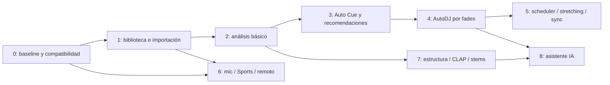

# LivePlay+: roadmap incremental

Fecha: 2026-09-30. Base: LivePlay 2.5.0, commit `44ac17c885ff4a6dde96e8332001735494ccc50e`. Estado: **propuesta; funcionalidades grandes no implementadas**. El diagnóstico, las referencias de código y la evaluación de herramientas están en [ARCHITECTURE.md](ARCHITECTURE.md).

## 1. Objetivo y reglas de evolución

Convertir el fork en una plataforma de show control, biblioteca musical y AutoDJ aprovechando el motor C++ y los contratos LivePlay existentes. El primer producto útil puede operar por fades, recomendaciones locales y carts antes de tener beat sync, stems o IA.

Reglas para cada fase:

- Abrir y reproducir proyectos LivePlay existentes, conservar IDs/routing y ofrecer exportación compatible con limitaciones explícitas.
- No depender de Internet/LLM para transporte, DSP, cues, Sports ni ejecución AutoDJ. Análisis pesado siempre fuera de render y cacheado.
- Mantener DSP y planes ejecutables deterministas, con tolerancias y fallbacks documentados.
- Probar Windows x64 primero: instalación limpia, MSVC/miniaudio, Unicode/espacios, workers ocultos y ejecución sin WSL ni GPU obligatoria.
- Revisar código, pesos, dependencias transitivas, binarios, licencias, releases/mantenimiento y empaquetado antes de añadir dependencias.
- Features avanzadas opt-in y capabilities negociadas; cliente/servidor upstream continúan con protocolo básico.

No se asignan fechas sin medir los PoC y acordar capacidad del equipo. Las fases siguientes tienen entregables y puertas de salida verificables.

## 2. Secuencia de dependencias

La fase 6 puede adelantarse después de las bases: Sports Event no necesita esperar beat sync ni IA. La fase 7 se divide en módulos independientes; que falle estructura/stems no retrasa la biblioteca básica. El asistente puede empezar sobre metadata convencional, pero la aplicación de sus propuestas depende del validador/planner.

## 3. Fases y criterios de salida

### Fase 0 — Baseline, contratos y preparación del fork

**Entregables**

- Fixtures de proyectos 1.x y 2.5: grupos, carts, roles Master/Preview, rutas, sends, DSP, in/out, fades, loops, Start Next, LTC y media faltante.
- Snapshot de API actual y estrategia de capabilities/namespace LivePlay+. Política de propiedad del estado, sidecar, export y backup.
- Baseline Windows con dos decks más carts, guardado, reconexión y churn de UI; registrar stats de render/cola/underruns/discontinuidades y loopback audible.
- Registro de decisiones de dependencias: versión, license/pesos, toolchain, costes y fallback. PoC de loudness y shortlist beat/key; sin integrarlos al camino de audio todavía.
- Revisar identidad del fork, upstream de actualización, producto/appId, firmas, fuentes/avisos AGPL y triggers de CI antes de distribuir LivePlay+.
- Revisar riesgos actuales que afectarán nuevas rutas: paths, acciones GET/HEAD, duplicación HTTP externa, persistencia de outputs y límites de archivos.

**Salida**: baseline reproducible, fixture de migración/round-trip aceptado y decisiones registradas. Guardar repetidamente sobre un `.liveplay` existente en Windows y con archivo bloqueado/disco lleno preserva la versión anterior o reporta fallo. Reproducción continúa al cerrar/reconectar el cliente y al desconectar Internet. Las limitaciones heredadas quedan identificadas, sin prometer tiempo real estricto por los snapshots actuales.

### Fase 1 — Biblioteca e importación masiva fiable

**Reutilizar**: AudioImportModal, PlaylistView, copy/upload/media APIs, TagLib, registro de AudioItem y loader existente.

**Entregables**

- LibraryService con Track/Asset y repositorio local detrás de interfaz; aprobar SQLite o alternativa acotada. Separar biblioteca de cues cargados al motor.
- ImportService con batch ID, staging, progreso, cancelación, reintentos y reanudación; orden de playlist estable. Ingestión/copia limitada en paralelo; publicación ordenada y guardado por lote.
- Deduplicación por hash exacto, resolución de nombres repetidos y política de originales/derivados. No mover ni retaggear destructivamente archivos del operador.
- Adaptar arrastrar/seleccionar/upload/servidor al mismo flujo. YouTube termina en ese flujo; modo remoto transfiere y registra el archivo en el servidor.
- Encapsular FFmpeg/yt-dlp. Mantener comportamiento compatible al reemplazar el wrapper archivado `fluent-ffmpeg`. Binarios/pesos fijados y disponibles antes del show; actualizaciones fuera de show.

**Salida**: lote de referencia de 1.000 archivos sin crear 1.000 voces activas ni asignar todo PCM en RAM; resultados por archivo; corruptos/duplicados no abortan el resto. Reiniciar durante copia no publica archivos parciales; reintento no duplica items. Probar local/remoto, Unicode, rutas largas/espacios, nombres iguales, recursos de red desconectados y disco lleno. Archivo importado es reproducible sin Internet.

### Fase 2 — Waveform, loudness, BPM/beatgrid y tonalidad

**Reutilizar**: generador/worker multicanal de waveform, WaveformCanvas/Trimmer, tipos de proyecto y meters live.

**Entregables**

- AnalysisScheduler durable con límites CPU/RAM/IO, DAG, timeout, cancelación y prioridad. Caché por contenido + versión/configuración/modelo; capa de overrides manuales.
- Consolidar waveform del servidor; mantener lector de formato Electron antiguo. Añadir resoluciones/overlays sólo si el editor lo necesita.
- LUFS integrado, LRA y máximo true peak offline con libebur128 o backend aprobado; distinguir normalización histórica y medición nueva. Ganancia no destructiva, con headroom para mezclas.
- PoC de Essentia u otro backend de beat/key evaluado en Windows antes de seleccionar. Beatgrid editable, downbeats, compás, segmentos de tempo y confianza; key/mode y Camelot derivado.
- Panel de estado por feature y corrección manual/tap tempo; revisión de resultados al cambiar media y versión del analizador.

**Salida**: segunda apertura reutiliza caché válido; cambiar bytes o algoritmo invalida sólo resultados afectados. Resultados atrasados no se aplican a un proyecto distinto. Fallar/cancelar un analizador no interrumpe cues. Un corpus etiquetado muestra métricas de errores de beats/downbeats, BPM doble/mitad, key y loudness/TP; las categorías de baja confianza se deshabilitan para sync automático. Comparar loudness/TP con referencia independiente y fijar tolerancias antes de aprobar backend.

### Fase 3 — Auto Cue musical y recomendaciones locales

**Reutilizar**: trims, loops, Start Next, Up Next, crossfade, grupos y preview.

**Entregables**

- CueProposal: entrada/salida útil, transiciones en frases/beats, loops y regiones. Primero heurísticas locales de silencio/energía/beatgrid; estructura semántica puede añadirse en fase 7.
- Preview y aplicación explícita de propuestas. No sobrescribir marcadores manuales al reanalizar.
- Ranking explicable por disponibilidad, tempo, tonalidad/Camelot, energía, duración/contexto, tags e historial; exclusiones duras y variedad.
- Fingerprints Chromaprint opcionales tras evaluar versión/backend/licencia; AcoustID/MusicBrainz y beets sólo como enriquecimiento opt-in con caché/condiciones verificadas.

**Salida**: reglas/versiones y entradas iguales producen ranking reproducible; nunca recomendar un archivo faltante como listo. Los overrides sobreviven save/load/export y reanálisis. Aplicar propuesta cambia únicamente los campos mostrados. Sin Internet o metadata tonal sigue existiendo una recomendación por reglas/fade o modo manual.

### Fase 4 — AutoDJ inicial con fades y control humano

**Reutilizar**: secuenciador servidor, crossfades, buses/DSP, arming y transporte actual.

**Entregables**

- AutoDjPlanner y estados Preparing/Ready/Playing/Transitioning/ManualOverride/Recovering; plan revisionado, preparación del siguiente asset y fallback.
- Cola editable, historial, duración objetivo y perfiles musicales. Mezcla armónica opcional: ranking y frases primero, sin depender aún de time stretching.
- Política de prioridad: Stop All/emergencia y operador prevalecen; cambio de Up Next invalida el plan pendiente de forma controlada.
- Deduplicación de órdenes/identidad de plan; evitar que dos controladores ejecuten planners competidores. La ejecución permanece en servidor.

**Salida**: ensayo de 2 horas offline con saltos, pausa, cues manuales y reconexión; sin duplicación de next ni reproducción simultánea inesperada. Si next no está preparado, ejecutar la política elegida (extender loop preparado, fade o intervención), sin esperar análisis dentro de la transición. Escuchar/medir sumas y niveles; conservar preview aislado. No anunciar beat sync en esta fase.

### Fase 5 — Motor preparado para beat sync y time stretching

**Dependencias**: presupuesto de fase 0, metadata validada de fase 2 y planes de fase 4. Es la fase de mayor riesgo de regresión de audio.

**Entregables**

- Fuentes PCM con lectura anticipada y buffers acotados; sacar IO/decode pesado del render, evitando carga íntegra de toda la biblioteca. Mantener PlaybackItem como adaptador para cues legacy.
- Scheduler con reloj de frames y comandos start/stop/curva/ratio con offset dentro de bloque. Preparación fuera de render, cancelación y generaciones; publicar topology/buffers preparados.
- PoC A/B Rubber Band y SoundTouch: calidad, latencia, tiempo máximo de bloque, memoria, transitorios y rango de tempo. Elegir backend/versiones por resultados, no por popularidad.
- Beat sync por beatgrid, fase/downbeat y límites de ratio; key lock/pitch como controles explícitos. Diferenciar reloj musical, fuente, salida audible y drift de hardware.
- Política LTC, loops, seeking y cambio de tasa con stretching. Derivados prerenderizados como fallback si el modo live no satisface presupuesto.

**Salida**: tests de impulsos/tones y loopback prueban timestamps, compensación de latencia y fase; corpus cubre BPM variable, grids malos y grandes seeks. Ejecutar todos los E2E de audio relevantes. Ninguna espera de red/modelo ni asignación no acotada en las rutas nuevas. Objetivo inicial de laboratorio: error de programación <= 1 frame antes de hardware y tiempo de render p99 < 50% del presupuesto de bloque, con cero underruns atribuibles a la feature durante ensayo de 2 horas en máquina de referencia. Estos son objetivos propuestos, no resultados medidos ni garantías del driver; documentar máximos, colas y desviación audible por separado.

### Fase 6 — Ducking de micrófono, Sports Event y remoto

**Se puede dividir y adelantar**: Sports/carts y vista remota después de fases 0/1; captura mic sólo después de resolver recursos/latencia del motor. No exige CLAP, stems ni un LLM.

**Entregables**

- Talkover manual primero; después captura de micrófono servidor, routing/sidechain, threshold/hysteresis, attack/hold/release y ganancia de duck separada. Mapping por máquina y monitor de actividad/fallo.
- SportsEventController con perfil editable, estados previa/juego/pausa/anotación/descanso/cierre, stingers, camas/colas y reglas de interrupción/retorno.
- Integrar carts, teclas/MIDI existentes y botones táctiles; registrar eventos, debounce e idempotencia. Scoreboard externo sólo mediante adaptador opcional y datos validados.
- Cliente remoto mínimo usando la API existente extendida: snapshots al reconectar, roles, feedback/aceptación y revisión de comandos. Evaluar TLS/VPN para acceso fuera de LAN.

**Salida**: reproducir una secuencia deportiva de ensayo con interrupciones rápidas, talkover, Stop All y caída del controlador; emergency/operador conservan prioridad. Cambiar fader mientras hay ducking no restaura un valor viejo. Desconectar mic/controlador/scoreboard aplica fallback documentado y no produce feedback ni dispara un cue duplicado. Dos clientes no ejecutan dos veces el mismo evento. Todo funciona offline.

### Fase 7 — Estructura, CLAP y stems como extras independientes

**Entregables**

- Estructura: PoC All-In-One en worker aislado; auditar NATTEN/madmom/pesos, artefacto reproducible Windows, intro/verso/coro/outro con confidence/editabilidad. Si el packaging falla, conservar heurísticas de fase 3 y proveedor intercambiable.
- CLAP: embeddings precalculados, búsqueda semántica y similitud offline; evaluación por consultas/pares anotados, almacenamiento e índice local. Licencia de checkpoint y dependencias documentada. No confundir con estándar de plugins CLAP.
- Stems: evaluar Spleeter como baseline y comparar calidad/mantenimiento/paquete de alternativas antes de elegir. Separation offline, almacenamiento local, hashes y shared transport para reproducción alineada.
- Model manager opcional: instalación previa explícita, versiones/hashes, espacio requerido, healthcheck y rollback. No autodownload durante show.

**Salida**: cada feature se puede desinstalar/desactivar sin afectar motor/show. Reiniciar/cerrar worker ML no termina el servidor. Segunda ejecución reutiliza caché; todos los modelos tienen condiciones de redistribución revisadas. Stems tienen misma longitud/tasa y offsets correctos; se mide suma/artefactos y se prueba seek/loop/mute/CPU. Original disponible como fallback. Los recursos ML se suspenden cuando el show necesita su presupuesto.

### Fase 8 — Asistente DJ con IA

**Entregables**

- Interfaz conversacional para buscar, explicar propuestas y construir borradores de sets/planes mediante IDs del catálogo.
- Contrato estructurado, validador local de permisos/archivos/tiempos/niveles/políticas y revisión del operador antes de ejecutar. El asistente no envía comandos libres al motor.
- Proveedor reemplazable, uso local opcional o servicio online opt-in; política de datos/credenciales y respuesta a timeout.
- Registro de propuestas y decisiones; pruebas con IDs inexistentes, prompt injection en tags y planes contradictorios.

**Salida**: sin proveedor, Internet o respuesta válida, el show y AutoDJ continúan. Respuestas erróneas no producen cambios ejecutables. El operador ve los cues/tiempos/reglas antes de aplicar; detener o tomar control cancela la programación pendiente de acuerdo con la autoridad del servidor.

## 4. Cobertura de todas las funciones solicitadas

| Función | Fase principal | Base / dependencia |
|---|---|---|
| Importación masiva | 1 | copy/upload/TagLib actuales |
| BPM y beatgrid | 2 | workers, caché y edición manual |
| Tonalidad/Camelot | 2 | key offline y confianza |
| LUFS/true peak | 2 | medición offline, meters live preservados |
| Waveform | 2 | canvas/generador actuales |
| Intro/coro/outro | 7 | heurísticas desde 3, estructura ML opcional |
| Auto Cue | 3 | regiones/beatgrid y cues existentes |
| Mezcla armónica | 3–5 | ranking tonal, fades primero, sync después |
| AutoDJ | 4 | planner y transporte servidor |
| Beat sync | 5 | scheduler de frames y beatgrid |
| Time stretching | 5 | backend nativo evaluado |
| Ducking micrófono | 6 | captura/sidechain o talkover manual |
| Control remoto | 6 | REST/WS actuales y snapshots |
| Sports Event | 6 | carts/grupos/perfil y prioridad |
| Recomendaciones inteligentes | 3 y 7 | reglas locales primero, CLAP opcional |
| CLAP | 7 | embeddings en worker |
| Stems | 7 | separación offline y shared transport |
| Asistente DJ IA | 8 | propuestas validadas y control del operador |

## 5. Matriz de validación y publicación

| Dimensión | Casos obligatorios | Evidencia requerida |
|---|---|---|
| Compatibilidad | 1.x/2.5, `.liveplay`/`.lpa`, sidecar ausente/desconocido, Save As | Round-trip y reproducción en versión upstream de referencia; advertencias de export avanzado |
| Audio/DSP | fades/loops/LTC, buses/sends/PFL, EQ/dynamics/width/limiter, sync/stems | CTest relevante + E2E con dispositivo y loopback; tolerancias numéricas |
| Contención | import/análisis/save/reconnect mientras suena | Stats de render/mutex/underruns/discontinuidades y memoria/IO comparadas con baseline |
| Offline / fallos | Internet/LLM/worker caído, file faltante, corrupto, disco lleno | Continuidad/fallback y job recuperable; sin artefactos parciales publicados |
| Windows | instalación limpia x64 sin dev tools/WSL, rutas Unicode/largas, antivirus/file lock | Paquete verificable con binarios/modelos fijados; smoke test en hardware de referencia |
| Datos | cambio de media, versión de analizador, proyecto durante job | Invalidación correcta, aislamiento y overrides intactos |
| Multi-cliente | órdenes simultáneas/repetidas y reconexión | Una ejecución por request/plan, prioridad y resync de snapshots |
| Dependencias | librería/pesos/binario/transitivos/servicio | Inventario de licencias, hashes, notas de mantenimiento y estrategia de rollback |

No basta con un mock sin audio para aprobar routing/DSP o continuidad. Los tests de integración pueden modificar usuarios/proyectos/outputs: usar un servidor desechable, no la instancia de un show. Comandos/suites existentes: [DEVELOPMENT.md](DEVELOPMENT.md) y [guía E2E](../server/tests/e2e/README.md).

## 6. Primer paquete de trabajo recomendado

1. Cerrar fase 0 con corpus legacy, protocolo y baseline Windows; fijar política de sidecar/capabilities.
2. Construir ImportService/LibraryService acotados y unificar YouTube/remoto sin tocar la mezcla/DSP.
3. Introducir AnalysisScheduler sobre waveform existente y PoC de loudness; validar caché por contenido.
4. Elegir beat/key mediante resultados y empaquetado Windows. Después implementar Auto Cue, recomendaciones y AutoDJ por fades.

Posponer beat sync, stretching, stems y asistente hasta cumplir sus puertas de salida. No iniciar una reescritura del motor, no añadir todas las herramientas candidatas de una vez y no introducir un host de plugins por la existencia del placeholder visual. El siguiente cambio de código debería pertenecer a un paquete concreto de estas fases, con criterio de aceptación acordado y fallback verificable.

## Avance: primera iteración funcional

La primera iteración implementó la base de biblioteca/importación del servidor de la fase 1: modelo Track separado, interfaz de repositorio con almacenamiento JSON, assets propios, deduplicación SHA-256, lotes persistentes/cancelables y endpoints /api/plus. Phase 1.5 completa después UI y benchmark e introduce interfaces analíticas; YouTube y waveform independiente siguen pendientes. Contrato, pruebas y límites actuales en [LIBRARY_IMPORT.md](LIBRARY_IMPORT.md).

## Phase 1.5 — Smart Library UI, robustness and analysis foundation

Implementado sobre la fase 1 existente:

- Dependencias cliente instaladas desde lockfile sin cambios de versión; type checking estabilizado, regresiones y build del renderer.
- Directorio Plus por plataforma, override portable y migración por copia sin borrar el origen. Catálogo y referencias propias portables.
- Detección de missing/corrupt, SHA-256, relink explícito, verificación/rebuild y limpieza seleccionada. Backups y recovery explícito con reinicio.
- Smart Library UI con multi-file picker/drop, metadata table, búsqueda/orden/filtros/paginación, progreso, duplicados, errores, cancelación/reintento, relink y mantenimiento.
- Interfaces y orquestación AnalysisScheduler/Job/Repository/Provider, schema nullable, persistencia independiente y protocolo JSON de worker futuro. Todas las capacidades musicales siguen false.
- Benchmark de 100/500/1.000 archivos distintos y cobertura nativa/API/renderer real; resultados y limitaciones en [LIBRARY_BENCHMARK](LIBRARY_BENCHMARK.md).

No se implementaron AutoDJ, beatmatching/sync, time stretching, stems, IA ni modelos pesados. SQLite no se introdujo.

## Phase 1.6 — Library Performance, Durability and Audio Isolation

Implementado sobre Phase 1.5:

- Journal de catálogo append-only con fsync, snapshots por reemplazo atómico, replay por secuencia e interrupciones recuperables. Las escrituras de Track son durables antes de publicarse; la compaction es coalescida y nunca sustituye un catálogo a medio escribir.
- Exclusión entre procesos mediante `StoreLock`; imports concurrentes se serializan y mantenimiento/compaction se coordinan en el repositorio. El error de lock es explícito y la recuperación se hace reabriendo el store.
- Performance Mode por defecto: con transporte activo reduce la cadencia de I/O de import, pausa compaction pesada y hace que el scheduler espere. Sin reproducción conserva rendimiento completo. No modifica la semántica del motor.
- Retry servidor para staging multipart retenido y reintentos de path; los handles `File` del navegador no se persisten. La UI informa este límite y usa traducciones English/Spanish para todas las cadenas Plus nuevas.
- Adaptador `ExternalAnalysisProvider` y worker mock externo con JSON Lines, request ID, protocol version, health, timeout, cancelación y recuperación de crash. Las capabilities musicales permanecen false.
- Benchmark ampliado a 100/500/1.000/5.000, métricas de journal/compaction/memoria y prueba E2E de 1.000 imports bajo reproducción continua. Resultados en [LIBRARY_BENCHMARK](LIBRARY_BENCHMARK.md) y [AUDIO_ISOLATION_TESTS](AUDIO_ISOLATION_TESTS.md).

La siguiente fase recomendada es un proveedor básico offline aislado que sólo emita el schema nullable ya versionado, tras una revisión de licencia/mantenimiento y un corpus Windows. No debe comenzar BPM, key, loudness, waveform, AutoDJ ni DSP de tiempo real en paralelo; cada capacidad necesita una puerta de aceptación y cache key propia.

## Phase 1.7 — Event MVP

Implemented as a narrow vertical slice: cached waveform requests, manual event tags, deterministic recommendations, optional FFmpeg basic loudness/peak analysis, cue editor with IN/OUT, presets, show-board phase groups, team/template scaffolding and emergency transport controls. It reuses the existing project item and audio engine contracts. BPM, key, beatgrid, AutoDJ planning, time stretching, stems, CLAP and AI remain explicitly deferred to Phase 2+.
